# Samay frontend — slim build

Flutter app (`samay`, `com.qallariy.samay`). This branch is the **slim
production version**: games only, guest-first, QR-centric.

## What this build is

- **No bottom navigation.** The app opens on a plain list of the four games;
  friends, groups, packs, notifications, profile and settings live in the
  header's expandable menu.
- **Guest-first, one tap.** A single "aceptar y jugar" button IS the 18+ /
  terms / privacy acceptance (the documents are inline links), and it creates
  the anonymous account. Apple/Google sign-in is optional and *links* the
  identity onto the existing guest (same uid), so nothing is lost.
- **Two ways to play**
  - *Single device* ("jugar ahora"): one phone, any number of players, fully
    local — no session, no network, prompts from the cached pack. Round 1 is
    dealt immediately with two default seats; names are edited mid-match.
  - *Multi-device*: a server partida joined by a **6-character code or QR**
    (`samay://join/<CODE>`), with a leave action for participants.
- **Prompt packs** are served by the backend, cached on device for offline play
  and gated by subscription tier (free / pro / vip) via RevenueCat.

Removed in this branch (to be re-added progressively): events, chat, feed,
photos, rankings, shards/wagers/cosmetics.

## Make

- `make init ENV=testing` → `make start ENV=testing` (= `make dev`).
- `ENV=testing-local|testing|staging|prod` drives **every** run/build/install
  verb; `staging`/`prod` are vault-gated and local-only. `ENV` is required.
- `make build ENV=… TARGET=ios-adhoc|simulator|android|all` · `make install ENV=…`.
- `make analyze check secrets hooks env` · `make test`.
- Release (local-only, vault-gated):
  `make build ENV=prod|staging TARGET=ios|android [MODE=adhoc]` ·
  `make deploy TARGET=… ENV=… TRACK=…`.

## Layout

| Path | What lives there |
|---|---|
| `lib/features/minigames/local/` | Single-device engine (pure Dart, unit-tested) |
| `lib/features/minigames/screens/local_match_screen.dart` | Single-device setup + play |
| `lib/features/minigames/screens/join_scanner_screen.dart` | QR join |
| `lib/features/packs/` | Prompt packs: service, cache-first repository, catalogue |
| `lib/features/auth/screens/onboarding_screen.dart` | The single consent gate |
| `lib/features/auth/screens/sign_in_screen.dart` | Optional account upgrade |
| `lib/core/router/` | No-nav route table (`route_paths.dart`, `app_router.dart`, guard) |

## Docs

`docs/design/DESIGN.md` · `docs/security/E2EE-ARCHITECTURE.md` ·
`docs/process/DEVELOPMENT-WORKFLOW.md` · `.opencode/DEV-SERVER.md`.

## Architecture

